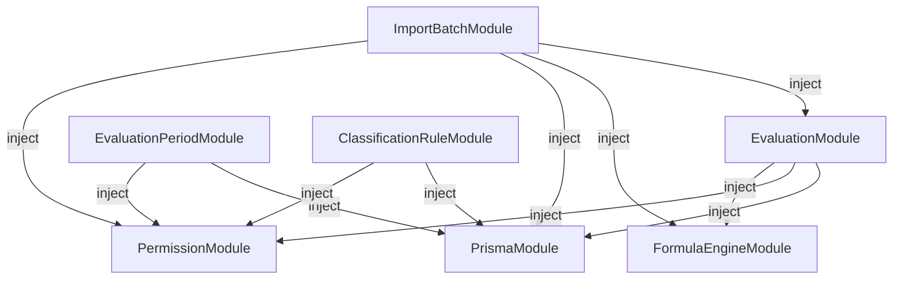

# Kế Hoạch Triển Khai Chi Tiết: Module Evaluation & Classification (Module 1D)

> **Mục tiêu**: Xây dựng toàn bộ hệ thống Đánh giá cá nhân (Evaluation) và Xếp loại động (Classification), bao gồm cả **quy trình Excel Import/Export + Staged Review** (duyệt trước khi lưu DB), theo đúng thiết kế Schema Prisma, chuẩn hóa luồng tính điểm, máy trạng thái (State Machine) và bảo mật RBAC 100% không lỗ hổng.

---

## 🗺️ PHẦN I: TỔNG QUAN KIẾN TRÚC & MÔ HÌNH DỮ LIỆU

### 1.1. Các thực thể đã có trong `schema.prisma`:
1. **`EvaluationPeriod`** — Kỳ đánh giá (startDate, endDate, kpiWeight, criteriaWeight).
2. **`EvaluationCriteria`** — Tiêu chí phụ thuộc kỳ (name, maxScore).
3. **`Evaluation`** — Phiếu đánh giá cá nhân (status: DRAFT→SUBMITTED→APPROVED/REJECTED, soft delete).
4. **`EvaluationCriteriaResult`** — Chi tiết chấm từng tiêu chí (selfScore, reviewerScore).
5. **`ClassificationRule`** — Thang xếp loại động (grade, label, minScore, maxScore).

### 1.2. Thực thể MỚI cần thêm vào `schema.prisma` (cho Excel Import/Export):

```prisma
// ─── IMPORT BATCH: Lô import Excel (áp dụng chung cho cả Evaluation và Task) ───
enum ImportBatchType {
  EVALUATION    // Import phiếu đánh giá
  TASK_METRIC   // Import số liệu metric của Task
}

enum ImportBatchStatus {
  PENDING     // Mới upload, đang chờ review
  APPROVED    // Đã duyệt → dữ liệu đã persist vào DB
  REJECTED    // Bị từ chối → dữ liệu bị loại bỏ
}

model ImportBatch {
  id String @id @default(uuid())

  type   ImportBatchType
  status ImportBatchStatus @default(PENDING)

  // Tên file gốc + URL lưu trữ file trên cloud
  originalFileName String
  fileUrl          String

  // Dữ liệu đã parse từ Excel, lưu dạng JSON
  // Mỗi row sẽ có thêm trường "errors" nếu validate thất bại
  parsedData Json

  // Thống kê tổng quan
  totalRows   Int @default(0)
  validRows   Int @default(0)
  invalidRows Int @default(0)

  // Ghi chú khi duyệt/từ chối
  reviewNote String?

  // Ai upload? Ai duyệt?
  uploadedById String
  uploadedBy   User   @relation("ImportUploader", fields: [uploadedById], references: [id])
  uploadedAt   DateTime @default(now())

  reviewedById String?
  reviewedBy   User?    @relation("ImportReviewer", fields: [reviewedById], references: [id])
  reviewedAt   DateTime?

  // Thuộc workspace nào? Và kỳ đánh giá nào (nullable vì TASK_METRIC không cần)?
  workspaceId String
  workspace   Workspace @relation(fields: [workspaceId], references: [id], onDelete: Cascade)

  periodId String?
  period   EvaluationPeriod? @relation(fields: [periodId], references: [id], onDelete: SetNull)

  createdAt DateTime @default(now())
  updatedAt DateTime @updatedAt
}
```

> [!IMPORTANT]
> **Bổ sung relation vào model `User` và `Workspace`:**
> - `User`: thêm `uploadedImports ImportBatch[] @relation("ImportUploader")` và `reviewedImports ImportBatch[] @relation("ImportReviewer")`
> - `Workspace`: thêm `importBatches ImportBatch[]`
> - `EvaluationPeriod`: thêm `importBatches ImportBatch[]`

---

## 🔄 PHẦN II: QUY TRÌNH NGHIỆP VỤ & STATE MACHINE

### 2.1. Luồng Evaluation — Nhập trên giao diện (UI Flow)

```
┌─────────────────────────────────────────────────────────────────────────────┐
│ 1. KHỞI TẠO KỲ ĐÁNH GIÁ (EvaluationPeriod)                               │
│    - Workspace Manager tạo kỳ: tên, thời gian, kpiWeight, criteriaWeight.  │
│    - Khai báo danh sách các tiêu chí con (EvaluationCriteria).             │
└──────────────────────────────────────┬──────────────────────────────────────┘
                                       │
                                       ▼
┌─────────────────────────────────────────────────────────────────────────────┐
│ 2. PHÁT HÀNH PHIẾU ĐÁNH GIÁ (Tạo Evaluation)                             │
│    - Tự động sinh phiếu cho các thành viên trong workspace (status: DRAFT).│
│    - Hoặc user tự tạo phiếu của mình khi bắt đầu kỳ.                     │
└──────────────────────────────────────┬──────────────────────────────────────┘
                                       │
                                       ▼
┌─────────────────────────────────────────────────────────────────────────────┐
│ 3. NHÂN VIÊN TỰ ĐÁNH GIÁ (Self Evaluation)                                │
│    - User nhập selfScore cho từng tiêu chí, nhập selfComment.              │
│    - Bấm NỘP PHIẾU → Chuyển status: SUBMITTED (Khóa không cho sửa nữa).  │
└──────────────────────────────────────┬──────────────────────────────────────┘
                                       │
                                       ▼
┌─────────────────────────────────────────────────────────────────────────────┐
│ 4. QUẢN LÝ ĐÁNH GIÁ & TÍNH ĐIỂM (Reviewer Evaluation)                    │
│    - Quản lý chấm reviewerScore cho từng tiêu chí, nhập reviewerComment.   │
│    - Hệ thống tự động:                                                     │
│      a) Tính criteriaScore từ reviewerScore các tiêu chí.                  │
│      b) Tổng hợp kpiScore từ KPISnapshot các Task hoàn thành trong kỳ.    │
│      c) finalScore = (kpiScore × kpiWeight) + (criteriaScore × criteriaW.) │
│      d) Tra cứu ClassificationRule → Gán classification.                   │
│    - Chuyển status: APPROVED (hoặc REJECTED nếu yêu cầu làm lại).         │
└─────────────────────────────────────────────────────────────────────────────┘
```

### 2.2. Luồng Excel Import/Export — Staged Review (ÁP DỤNG CHO CẢ EVALUATION & TASK METRIC)

```
┌──────────────────────────────────────────────────────────────────────────────┐
│ BƯỚC A: EXPORT TEMPLATE EXCEL                                               │
│  - Manager gọi API export → Backend tạo file Excel template (.xlsx)         │
│    với header chuẩn và dropdown validation.                                  │
│  - Gửi file Excel cho người nhập liệu (bên ngoài hệ thống).               │
└───────────────────────────────────────┬──────────────────────────────────────┘
                                        │
                                        ▼
┌──────────────────────────────────────────────────────────────────────────────┐
│ BƯỚC B: IMPORT FILE EXCEL → PARSE & VALIDATE → TẠO ImportBatch (PENDING)   │
│  - Manager upload file Excel đã điền → API nhận file.                       │
│  - Backend parse từng row:                                                   │
│    ▸ Map email → userId (kiểm tra tồn tại trong workspace)                  │
│    ▸ Validate dữ liệu: score phải là số, trong range cho phép, etc.        │
│    ▸ Đánh dấu row hợp lệ ✅ / row lỗi ❌ (kèm thông báo lỗi cụ thể)      │
│  - Lưu kết quả parse vào ImportBatch.parsedData (JSON).                     │
│  - Status mặc định: PENDING.                                                │
│  - Trả về preview: tổng rows, valid, invalid, danh sách lỗi.               │
└───────────────────────────────────────┬──────────────────────────────────────┘
                                        │
                                        ▼
┌──────────────────────────────────────────────────────────────────────────────┐
│ BƯỚC C: REVIEW PREVIEW DATA                                                 │
│  - Manager xem lại dữ liệu đã parse trên giao diện FE:                    │
│    ▸ Danh sách row hợp lệ + row lỗi                                        │
│    ▸ Chi tiết từng lỗi (email không tồn tại, score vượt range, etc.)       │
│  - Manager có thể:                                                          │
│    ▸ Chỉnh sửa trực tiếp parsedData (call PATCH API sửa từng row)         │
│    ▸ Hoặc upload lại file mới (tạo ImportBatch mới, hủy cái cũ)           │
└───────────────────────────────────────┬──────────────────────────────────────┘
                                        │
                                        ▼
┌──────────────────────────────────────────────────────────────────────────────┐
│ BƯỚC D: APPROVE / REJECT IMPORT BATCH                                       │
│  ┌─ APPROVE:                                                                │
│  │  - Ràng buộc: Chỉ APPROVE khi invalidRows === 0.                        │
│  │  - Backend đọc parsedData → thực thi transaction:                        │
│  │    ▸ [EVALUATION]: Upsert Evaluation + EvaluationCriteriaResult          │
│  │      cho từng row, tính điểm, gán xếp loại.                             │
│  │    ▸ [TASK_METRIC]: Upsert TaskMetricValue cho từng row,                 │
│  │      gọi FormulaEngine tính KPISnapshot.                                │
│  │  - Chuyển status → APPROVED, ghi reviewedById & reviewedAt.             │
│  ├─ REJECT:                                                                │
│  │  - Ghi reviewNote (lý do reject), chuyển status → REJECTED.              │
│  │  - Không ảnh hưởng dữ liệu gì trong DB.                                │
│  └──────────────────────────────────────────────────────────────────────────│
└──────────────────────────────────────────────────────────────────────────────┘
```

---

## 🧮 PHẦN III: CÔNG THỨC TÍNH TOÁN TOÁN HỌC (CHUẨN XÁC 100%)

### A. Điểm Tiêu Chí Mềm (`criteriaScore`):
```
criteriaScore = (Σ reviewerScore_i / Σ maxScore_i) × 10
```
*(Nếu chưa có tiêu chí nào → mặc định = 0)*

### B. Điểm KPI (`kpiScore`):
```
kpiScore = Average(KPISnapshot.finalScore)  // Các Task hoàn thành trong kỳ [startDate, endDate]
```
*(Nếu không có Task KPI nào → mặc định = 0)*

### C. Điểm Tổng Kết (`finalScore`):
```
finalScore = (kpiScore × kpiWeight) + (criteriaScore × criteriaWeight)
```

### D. Xếp loại tự động (`classification`):
```
Tìm ClassificationRule WHERE minScore ≤ finalScore ≤ maxScore → Gán classification = rule.grade + " - " + rule.label
```

---

## 🛡️ PHẦN IV: MA TRẬN PHÂN QUYỀN RBAC CHI TIẾT

### 4.1. Permission Keys mới (trong `pemission.constants.ts`):

| Group | Key | Mô tả |
|-------|-----|--------|
| **EvaluationPeriod** | `evaluation-period:view` | Xem kỳ đánh giá |
| | `evaluation-period:create` | Tạo kỳ đánh giá |
| | `evaluation-period:update` | Cập nhật kỳ đánh giá |
| | `evaluation-period:delete` | Xóa kỳ đánh giá |
| **Evaluation** | `evaluation:view` | Xem phiếu của chính mình |
| | `evaluation:view-all` | Xem tất cả phiếu trong workspace |
| | `evaluation:submit` | Tự nộp phiếu (self evaluate) |
| | `evaluation:review` | Chấm duyệt phiếu người khác |
| **Classification** | `classification:view` | Xem thang xếp loại |
| | `classification:manage` | CRUD thang xếp loại |
| **Import** | `import:upload` | Upload file Excel import |
| | `import:review` | Review và Approve/Reject lô import |

### 4.2. Gán quyền cho các Role mặc định:

| Permission Key | WS Manager | Project Lead | Member | Viewer |
|---------------|:----------:|:------------:|:------:|:------:|
| `evaluation-period:view` | ✅ | ✅ | ✅ | ✅ |
| `evaluation-period:create` | ✅ | ❌ | ❌ | ❌ |
| `evaluation-period:update` | ✅ | ❌ | ❌ | ❌ |
| `evaluation-period:delete` | ✅ | ❌ | ❌ | ❌ |
| `evaluation:view` | ✅ | ✅ | ✅ | ❌ |
| `evaluation:view-all` | ✅ | ✅ | ❌ | ❌ |
| `evaluation:submit` | ✅ | ✅ | ✅ | ❌ |
| `evaluation:review` | ✅ | ✅ | ❌ | ❌ |
| `classification:view` | ✅ | ✅ | ✅ | ✅ |
| `classification:manage` | ✅ | ❌ | ❌ | ❌ |
| `import:upload` | ✅ | ✅ | ❌ | ❌ |
| `import:review` | ✅ | ❌ | ❌ | ❌ |

> [!NOTE]
> **Super Admin**: Bypass toàn bộ RBAC, luôn có full quyền.

---

## 📋 PHẦN V: KẾ HOẠCH TRIỂN KHAI TỪNG BƯỚC (STEP-BY-STEP)

> [!WARNING]
> **Thứ tự bắt buộc** — Mỗi bước phụ thuộc bước trước. KHÔNG nhảy bước.

---

### ═══════════════════════════════════════════════
### BƯỚC 1: CẬP NHẬT SCHEMA PRISMA & SEED RBAC
### ═══════════════════════════════════════════════

**Mục tiêu**: Thêm model `ImportBatch` vào schema, bổ sung relation, thêm permission keys mới.

#### 1.1. Cập nhật `prisma/schema.prisma`:
- [ ] Thêm 2 enum mới: `ImportBatchType` (`EVALUATION`, `TASK_METRIC`) và `ImportBatchStatus` (`PENDING`, `APPROVED`, `REJECTED`).
- [ ] Thêm model `ImportBatch` (như mô tả ở Phần I.2).
- [ ] Thêm relation vào `User`:
  ```
  uploadedImports  ImportBatch[] @relation("ImportUploader")
  reviewedImports  ImportBatch[] @relation("ImportReviewer")
  ```
- [ ] Thêm relation vào `Workspace`:
  ```
  importBatches ImportBatch[]
  ```
- [ ] Thêm relation vào `EvaluationPeriod`:
  ```
  importBatches ImportBatch[]
  ```

#### 1.2. Cập nhật Permission Constants:
- [ ] Mở file [`src/permission/constants/pemission.constants.ts`](file:///home/ximent/AGU/KhoaLuanTotNghiep/TaskMenT/tm-backend/src/permission/constants/pemission.constants.ts).
- [ ] Thêm tất cả 12 permission keys mới (bảng ở Phần IV.1).

#### 1.3. Cập nhật Role Definitions & Seed:
- [ ] Mở file [`src/workspace/workspace.service.ts`](file:///home/ximent/AGU/KhoaLuanTotNghiep/TaskMenT/tm-backend/src/workspace/workspace.service.ts) → Bổ sung các permission keys vào `ROLE_DEFINITIONS` cho từng role (Manager, Lead, Member, Viewer) theo ma trận Phần IV.2.
- [ ] Mở file `prisma/seed.ts` → Bổ sung tương tự.

#### 1.4. Chạy migration & seed:
```bash
npx prisma migrate dev --name add-import-batch
npx prisma db seed
```

#### ✅ Kiểm tra sau Bước 1:
- [ ] `npx prisma validate` → 0 lỗi.
- [ ] Prisma Studio → Thấy bảng `ImportBatch` mới.
- [ ] Bảng `Permission` → Có đầy đủ 12 keys mới.
- [ ] Bảng `RolePermission` → Các role đã được gán đúng permissions.

---

### ═══════════════════════════════════════════════
### BƯỚC 2: MODULE `ClassificationRule` (Thang xếp loại)
### ═══════════════════════════════════════════════

**Thư mục**: `src/classification-rule/` *(đã tạo sẵn, cần review & hoàn thiện)*

**Trạng thái hiện tại**: Service 91 dòng, Controller 50 dòng — Cần kiểm tra lại RBAC & logic.

#### 2.1. DTOs — File `dto/create-classification-rule.dto.ts`:
- [ ] Các trường: `grade` (string, required), `label` (string, required), `minScore` (number, ≥ 0), `maxScore` (number, ≥ minScore), `description?` (string, optional), `workspaceId` (string, required).
- [ ] Thêm custom validator: kiểm tra `maxScore >= minScore`.

#### 2.2. Service — File `classification-rule.service.ts`:

| Method | Logic nghiệp vụ | RBAC Check |
|--------|-----------------|------------|
| `create(dto, user)` | Tạo rule mới. **Validate**: Không được gối khoảng điểm (overlap) với rule khác trong cùng workspace. | Guard: `@RequirePermission(CLASSIFICATION_MANAGE)` |
| `findByWorkspace(workspaceId, user)` | Lấy tất cả rules, sắp xếp theo `minScore ASC`. | Service: `assertWorkspaceMember(user, workspaceId)` |
| `update(id, dto, user)` | Fetch rule → Lấy `workspaceId` → **Validate overlap** (loại trừ rule đang update). | Service: `assertPermission(user, workspaceId, CLASSIFICATION_MANAGE)` |
| `remove(id, user)` | Fetch rule → Lấy `workspaceId` → Xóa hard delete. | Service: `assertPermission(user, workspaceId, CLASSIFICATION_MANAGE)` |

#### 2.3. Controller — File `classification-rule.controller.ts`:

| Route | Method | Guard/Decorator |
|-------|--------|-----------------|
| `POST /classification-rule` | `create()` | `@RequirePermission(CLASSIFICATION_MANAGE)` |
| `GET /classification-rule/workspace/:workspaceId` | `findByWorkspace()` | `JwtAuthGuard` only (check member ở service) |
| `PATCH /classification-rule/:id` | `update()` | `JwtAuthGuard` only (check quyền ở service) |
| `DELETE /classification-rule/:id` | `remove()` | `JwtAuthGuard` only (check quyền ở service) |

#### 2.4. Validate chống overlap:
```
// Pseudocode - kiểm tra overlap
const overlapping = await prisma.classificationRule.findFirst({
  where: {
    workspaceId,
    id: { not: excludeId },  // loại trừ bản thân khi update
    OR: [
      { minScore: { lte: dto.maxScore }, maxScore: { gte: dto.minScore } },
    ],
  },
});
if (overlapping) throw ConflictException('Khoảng điểm bị gối với rule: ' + overlapping.grade);
```

#### ✅ Kiểm tra sau Bước 2:
- [ ] Tạo 4 rules: A(8-10), B(6-8), C(4-6), D(0-4) → Thành công.
- [ ] Tạo rule E(7-9) → Phải báo lỗi overlap với A và B.
- [ ] Member xem rules → OK. Member tạo rule → Bị chặn 403.

---

### ═══════════════════════════════════════════════
### BƯỚC 3: MODULE `EvaluationPeriod` (Kỳ đánh giá & Tiêu chí)
### ═══════════════════════════════════════════════

**Thư mục**: `src/evaluation-period/` *(đã code, 242 dòng service — cần review)*

#### 3.1. DTOs:

| DTO | Trường | Validation |
|-----|--------|------------|
| `CreateEvaluationPeriodDto` | `name`, `startDate`, `endDate`, `kpiWeight`, `criteriaWeight`, `workspaceId`, `criteria[]` | `kpiWeight + criteriaWeight === 1.0`, `endDate > startDate` |
| `CreateCriteriaDto` | `name`, `description?`, `maxScore` | `maxScore > 0` |
| `UpdateEvaluationPeriodDto` | Partial của Create | Giữ nguyên validation |
| `UpdateCriteriaDto` | Partial của CreateCriteria | — |

#### 3.2. Service — File `evaluation-period.service.ts`:

| Method | Logic nghiệp vụ | RBAC Check |
|--------|-----------------|------------|
| `create(dto, user)` | Tạo kỳ đánh giá + `criteria.createMany` trong **transaction**. | Guard: `@RequirePermission(EVALUATION_PERIOD_CREATE)` |
| `findAllByWorkspace(wsId, user)` | Lấy danh sách kỳ, sắp xếp `startDate DESC`. Include count evaluations. | Service: `assertWorkspaceMember` |
| `findOne(id, user)` | Lấy chi tiết kỳ kèm criteria + thống kê số phiếu theo status. | Service: `assertWorkspaceMember` (resolve wsId từ period) |
| `update(id, dto, user)` | Fetch period → resolve `workspaceId`. | Service: `assertPermission(EVALUATION_PERIOD_UPDATE)` |
| `remove(id, user)` | **RULE**: Không xóa nếu kỳ có phiếu ở status `SUBMITTED` hoặc `APPROVED`. | Service: `assertPermission(EVALUATION_PERIOD_DELETE)` |
| `addCriteria(periodId, dto, user)` | Thêm tiêu chí vào kỳ đang tồn tại. | Service: `assertPermission(EVALUATION_PERIOD_UPDATE)` |
| `updateCriteria(criteriaId, dto, user)` | Fetch criteria → resolve period → resolve workspace. | Service: `assertPermission(EVALUATION_PERIOD_UPDATE)` |
| `removeCriteria(criteriaId, user)` | Fetch criteria → resolve. **RULE**: Không xóa nếu đã có `EvaluationCriteriaResult` tham chiếu. | Service: `assertPermission(EVALUATION_PERIOD_UPDATE)` |

#### 3.3. Controller:

| Route | Method | Guard/Decorator |
|-------|--------|-----------------|
| `POST /evaluation-period` | `create()` | `@RequirePermission(EVALUATION_PERIOD_CREATE)` |
| `GET /evaluation-period/workspace/:workspaceId` | `findAllByWorkspace()` | JwtAuthGuard (check member ở service) |
| `GET /evaluation-period/:id` | `findOne()` | JwtAuthGuard (check member ở service) |
| `PATCH /evaluation-period/:id` | `update()` | JwtAuthGuard (check quyền ở service) |
| `DELETE /evaluation-period/:id` | `remove()` | JwtAuthGuard (check quyền ở service) |
| `POST /evaluation-period/:id/criteria` | `addCriteria()` | JwtAuthGuard (check quyền ở service) |
| `PATCH /evaluation-period/criteria/:criteriaId` | `updateCriteria()` | JwtAuthGuard (check quyền ở service) |
| `DELETE /evaluation-period/criteria/:criteriaId` | `removeCriteria()` | JwtAuthGuard (check quyền ở service) |

#### ✅ Kiểm tra sau Bước 3:
- [ ] Tạo kỳ Q1/2026 với 3 tiêu chí → OK.
- [ ] Tạo kỳ với `kpiWeight=0.7, criteriaWeight=0.4` → Phải báo lỗi (tổng ≠ 1).
- [ ] Member tạo kỳ → Bị chặn 403. Member xem kỳ → OK.
- [ ] Xóa kỳ đã có phiếu SUBMITTED → Phải báo lỗi.

---

### ═══════════════════════════════════════════════
### BƯỚC 4: MODULE `Evaluation` (Phiếu đánh giá & Máy tính điểm)
### ═══════════════════════════════════════════════

**Thư mục**: `src/evaluation/` *(hiện tại chỉ scaffold, cần code từ đầu)*

**Dependency**: Cần inject `PrismaService`, `PermissionService`, `FormulaEngineService` (hoặc import trực tiếp KPI module).

#### 4.1. DTOs:

| DTO | Trường | Mô tả |
|-----|--------|-------|
| `GenerateEvaluationsDto` | `periodId: string` | Tạo phiếu hàng loạt cho tất cả member |
| `SelfEvaluateDto` | `selfComment?: string`, `criteriaResults: { criteriaId: string, score: number, comment?: string }[]` | Nhân viên tự chấm |
| `ReviewEvaluateDto` | `reviewerComment?: string`, `status: 'APPROVED' \| 'REJECTED'`, `criteriaResults: { criteriaId: string, score: number, comment?: string }[]` | Quản lý chấm duyệt |

#### 4.2. Service — File `evaluation.service.ts` (VIẾT MỚI HOÀN TOÀN):

| # | Method | Logic nghiệp vụ chi tiết | RBAC |
|---|--------|--------------------------|------|
| 1 | `generateForPeriod(periodId, user)` | ① Fetch period + include criteria + workspace.members. ② Với mỗi member: tạo Evaluation(DRAFT) + createMany EvaluationCriteriaResult (selfScore=0, reviewerScore=0). ③ Dùng `skipDuplicates: true` (hoặc check `@@unique` trước) để tránh tạo trùng. ④ Trả về count phiếu đã tạo. | Service: `assertPermission(user, wsId, EVALUATION_PERIOD_CREATE)` |
| 2 | `getMyEvaluations(userId, query)` | Lọc `where: { userId, deletedAt: null }`. Include period.name, criteriaResults. Support phân trang + filter theo periodId. | Chỉ cần JWT (user xem phiếu chính mình) |
| 3 | `findAllByPeriod(periodId, user)` | Fetch period → resolve wsId. Lấy tất cả phiếu trong kỳ, include user.name + criteriaResults. | Service: `assertPermission(user, wsId, EVALUATION_VIEW_ALL)` |
| 4 | `findOne(id, user)` | Fetch evaluation + include period, user, reviewer, criteriaResults, criteriaResults.evaluationCriteria. ① Nếu user.id === evaluation.userId → OK (xem phiếu mình). ② Nếu user có quyền `EVALUATION_VIEW_ALL` trong workspace → OK. ③ Nếu user.id === evaluation.reviewerId → OK. ④ Nếu Super Admin → OK. ⑤ Khác → 403. | Logic tự kiểm tra (multi-condition) |
| 5 | `selfEvaluate(id, dto, user)` | ① Fetch evaluation. ② Assert `user.id === evaluation.userId` (chỉ chủ phiếu). ③ Assert status là `DRAFT` hoặc `REJECTED` (không cho sửa sau khi SUBMITTED). ④ Upsert EvaluationCriteriaResult: set `selfScore`. ⑤ Update Evaluation: set `selfComment`, status → `SUBMITTED`. | Owner-only check trong service |
| 6 | `review(id, dto, user)` | ① Fetch evaluation + period. ② Assert `user.id !== evaluation.userId` (không tự review). ③ Assert quyền `EVALUATION_REVIEW`. ④ Assert status === `SUBMITTED`. ⑤ Upsert reviewerScore cho từng criteria. ⑥ **Nếu dto.status === APPROVED**: Tính `criteriaScore` (công thức Phần III.A) → Query KPISnapshot tính `kpiScore` → Tính `finalScore` → Query ClassificationRule → Gán classification. ⑦ **Nếu dto.status === REJECTED**: Chuyển status → REJECTED, ghi reviewerComment. ⑧ Lưu reviewerId = user.id. | Service: `assertPermission(EVALUATION_REVIEW)` + owner-guard |
| 7 | `remove(id, user)` | Soft delete: `update({ deletedAt: new Date() })`. | Service: `assertPermission(EVALUATION_PERIOD_DELETE)` |

> [!CAUTION]
> **Method `review()` là phức tạp nhất.** Phải đảm bảo:
> 1. Transaction bọc toàn bộ: upsert criteria → tính điểm → gán classification → update evaluation.
> 2. Nếu không tìm thấy ClassificationRule phù hợp → Vẫn save điểm nhưng `classification = null` (không crash).
> 3. Không cho phép user review chính phiếu của mình (dù có quyền `EVALUATION_REVIEW`).

#### 4.3. Controller — File `evaluation.controller.ts`:

| Route | Method | Guard/Decorator |
|-------|--------|-----------------|
| `POST /evaluation/generate` | `generateForPeriod()` | `@RequirePermission(EVALUATION_PERIOD_CREATE)` |
| `GET /evaluation/me` | `getMyEvaluations()` | JwtAuthGuard only |
| `GET /evaluation/period/:periodId` | `findAllByPeriod()` | JwtAuthGuard (check quyền VIEW_ALL ở service) |
| `GET /evaluation/:id` | `findOne()` | JwtAuthGuard (multi-condition check ở service) |
| `PATCH /evaluation/:id/self-evaluate` | `selfEvaluate()` | JwtAuthGuard (owner check ở service) |
| `PATCH /evaluation/:id/review` | `review()` | JwtAuthGuard (check quyền + anti-self-review ở service) |
| `DELETE /evaluation/:id` | `remove()` | JwtAuthGuard (check quyền ở service) |

> [!IMPORTANT]
> **Lưu ý thứ tự route**: `GET /evaluation/me` và `GET /evaluation/period/:periodId` PHẢI đặt **TRƯỚC** `GET /evaluation/:id` trong controller, nếu không NestJS sẽ match nhầm `me` hoặc `period` thành `:id`.

#### ✅ Kiểm tra sau Bước 4:
- [ ] Generate phiếu cho kỳ Q1 → Tạo thành công cho tất cả member.
- [ ] Generate lại → Không tạo trùng.
- [ ] Member A tự chấm → Submit OK. Member A sửa phiếu sau khi SUBMITTED → Bị chặn.
- [ ] Manager review phiếu A → APPROVE → `finalScore` và `classification` được tính đúng.
- [ ] Member A cố review phiếu của chính mình → Bị chặn 403.
- [ ] Member B cố xem phiếu A → Bị chặn 403 (B không có quyền VIEW_ALL).

---

### ═══════════════════════════════════════════════
### BƯỚC 5: MODULE `ImportBatch` (Excel Import/Export + Staged Review)
### ═══════════════════════════════════════════════

**Thư mục MỚI**: `src/import-batch/`

**Library cần cài**: `npm install exceljs` — Thư viện đọc/ghi file Excel .xlsx (hỗ trợ streaming, template, data validation).

> [!NOTE]
> Tại sao chọn `exceljs` thay vì `xlsx` (SheetJS)?
> - `exceljs` hỗ trợ streaming (xử lý file lớn), kiểu dữ liệu cột, data validation (dropdown), styling.
> - `xlsx` nhanh hơn cho parse đơn giản, nhưng thiếu nhiều tính năng tạo template.
> - Cả 2 đều miễn phí. `exceljs` phù hợp hơn vì ta cần **tạo template có format**.

#### 5.1. Cấu trúc file:

```
src/import-batch/
├── import-batch.module.ts
├── import-batch.controller.ts
├── import-batch.service.ts
├── dto/
│   ├── import-file.dto.ts
│   ├── review-import.dto.ts
│   └── update-parsed-row.dto.ts
├── parsers/
│   ├── evaluation.parser.ts      ← Parse + validate rows cho Evaluation
│   └── task-metric.parser.ts     ← Parse + validate rows cho Task Metric
└── exporters/
    ├── evaluation.exporter.ts    ← Tạo template Excel cho Evaluation
    └── task-metric.exporter.ts   ← Tạo template Excel cho Task Metric
```

#### 5.2. Template Excel — Evaluation (`evaluation.exporter.ts`):

**Mục đích**: Tạo file Excel template để người dùng bên ngoài điền điểm đánh giá.

**Cấu trúc file Excel xuất ra:**

| # | Column | Mô tả | Auto-fill? |
|---|--------|-------|:----------:|
| A | STT | Số thứ tự | ✅ |
| B | Email | Email nhân viên (để map userId) | ✅ |
| C | Họ tên | Tên nhân viên (để dễ đọc, KHÔNG dùng để import) | ✅ |
| D | [Tiêu chí 1] - selfScore | Điểm tự chấm tiêu chí 1 | ❌ (người nhập) |
| E | [Tiêu chí 1] - reviewerScore | Điểm quản lý chấm tiêu chí 1 | ❌ (người nhập) |
| F | [Tiêu chí 2] - selfScore | ... | ❌ |
| G | [Tiêu chí 2] - reviewerScore | ... | ❌ |
| ... | ... | Lặp cho mỗi tiêu chí | ... |
| N | selfComment | Nhận xét tự đánh giá | ❌ |
| N+1 | reviewerComment | Nhận xét của quản lý | ❌ |

**Logic export:**
1. Fetch EvaluationPeriod + criteria + workspace.members.
2. Tạo workbook ExcelJS → Sheet "Đánh giá".
3. Row 1: Header (tên các cột, bold, background color).
4. Row 2+: Mỗi member 1 row, auto-fill STT + Email + Tên.
5. Data validation: score columns → số từ 0 đến `maxScore` của tiêu chí tương ứng.
6. Sheet ẩn "metadata": Lưu `periodId`, `workspaceId`, danh sách `criteriaId` theo thứ tự cột (để khi import biết cột nào map tiêu chí nào).

#### 5.3. Template Excel — Task Metric (`task-metric.exporter.ts`):

**Mục đích**: Tạo file Excel template để nhập số liệu metric cho các Task trong workspace.

**Cấu trúc file Excel:**

| # | Column | Mô tả | Auto-fill? |
|---|--------|-------|:----------:|
| A | STT | Số thứ tự | ✅ |
| B | Task ID | ID của task | ✅ |
| C | Tên Task | Tiêu đề task (để đọc) | ✅ |
| D | Assignee Email | Email người được giao | ✅ |
| E | Formula | Công thức đang áp dụng | ✅ (readonly) |
| F | [Metric 1 Key] | Giá trị metric 1 | ❌ (người nhập) |
| G | [Metric 2 Key] | Giá trị metric 2 | ❌ |
| ... | ... | Lặp cho mỗi metric trong workspace | ... |

**Logic export:**
1. Fetch Tasks trong workspace/project (filter tuỳ query: projectId, periodDate range...).
2. Fetch Metrics thuộc workspace.
3. Tạo workbook → Sheet "Task Metrics".
4. Auto-fill Task ID, Title, Assignee, Formula name.
5. Sheet ẩn "metadata": Lưu `workspaceId`, danh sách `metricId` theo thứ tự cột.

#### 5.4. Parser — Evaluation (`evaluation.parser.ts`):

**Input**: File buffer (xlsx) + workspaceId + periodId.

**Output**: `ParsedRow[]`

```typescript
interface ParsedEvaluationRow {
  rowIndex: number;
  email: string;
  userId: string | null;      // null nếu không tìm thấy
  userName: string;
  criteriaScores: {
    criteriaId: string;
    selfScore: number | null;
    reviewerScore: number | null;
  }[];
  selfComment: string | null;
  reviewerComment: string | null;
  errors: string[];            // Danh sách lỗi validation
  isValid: boolean;
}
```

**Validation rules:**
1. `email` phải map được tới một `WorkspaceMember` trong workspace → Nếu không: error "Email không thuộc workspace".
2. Mỗi `score` phải là số >= 0 và <= `maxScore` của tiêu chí tương ứng → Nếu không: error "Điểm tiêu chí X vượt giới hạn".
3. Không cho phép row trùng email trong cùng file → error "Email bị trùng ở dòng Y".
4. User đã có phiếu APPROVED trong kỳ này → warning "Phiếu đã duyệt, sẽ bị ghi đè".

#### 5.5. Parser — Task Metric (`task-metric.parser.ts`):

**Validation rules:**
1. `taskId` phải tồn tại và thuộc workspace.
2. Mỗi giá trị metric phải là số.
3. Task phải có formula được gán (để tính KPI).

#### 5.6. Service — File `import-batch.service.ts`:

| # | Method | Logic | RBAC |
|---|--------|-------|------|
| 1 | `exportEvaluationTemplate(periodId, user)` | Gọi `evaluation.exporter` → trả về buffer xlsx. | Service: `assertPermission(IMPORT_UPLOAD)` |
| 2 | `exportTaskMetricTemplate(query, user)` | Gọi `task-metric.exporter` → trả về buffer xlsx. | Service: `assertPermission(IMPORT_UPLOAD)` |
| 3 | `importFile(file, type, workspaceId, periodId?, user)` | ① Lưu file lên cloud (hoặc local). ② Gọi parser tương ứng (evaluation/task-metric). ③ Tạo ImportBatch với parsedData, totalRows, validRows, invalidRows. ④ Trả về ImportBatch + preview. | Guard: `@RequirePermission(IMPORT_UPLOAD)` |
| 4 | `findAllByWorkspace(wsId, query, user)` | Lấy danh sách batches, filter theo type/status. | Service: `assertWorkspaceMember` |
| 5 | `findOne(id, user)` | Lấy chi tiết batch + parsedData. | Service: `assertWorkspaceMember` |
| 6 | `updateParsedRow(batchId, rowIndex, data, user)` | Sửa 1 row trong parsedData JSON → Re-validate row đó. Chỉ khi status=PENDING. | Service: `assertPermission(IMPORT_REVIEW)` |
| 7 | `approve(id, user)` | ① Assert status=PENDING. ② Assert invalidRows=0 (không approve khi còn lỗi). ③ Transaction: Đọc parsedData → **Nếu EVALUATION**: Upsert Evaluation + CriteriaResult, tính điểm, gán classification. **Nếu TASK_METRIC**: Upsert TaskMetricValue, gọi FormulaEngine tính KPISnapshot. ④ Update status=APPROVED. | Service: `assertPermission(IMPORT_REVIEW)` |
| 8 | `reject(id, dto, user)` | Assert status=PENDING. Update status=REJECTED, ghi reviewNote. | Service: `assertPermission(IMPORT_REVIEW)` |

> [!CAUTION]
> **Method `approve()` là CRITICAL.** Chi tiết transaction cho từng type:
>
> **Type EVALUATION:**
> ```
> for each validRow in parsedData:
>   1. Upsert Evaluation (periodId + userId unique)
>   2. Upsert EvaluationCriteriaResult cho từng criteria
>   3. Tính criteriaScore = Σ reviewerScore / Σ maxScore × 10
>   4. Query KPISnapshot → tính kpiScore
>   5. finalScore = kpiScore × kpiWeight + criteriaScore × criteriaWeight
>   6. Query ClassificationRule → gán classification
>   7. Update evaluation: kpiScore, criteriaScore, finalScore, classification, status=APPROVED
> ```
>
> **Type TASK_METRIC:**
> ```
> for each validRow in parsedData:
>   1. Upsert TaskMetricValue cho từng metric
>   2. Fetch Task.formula → Gọi FormulaEngine.calculate(expression, metricValues)
>   3. Upsert KPISnapshot: finalScore, expression, version, metricValues
> ```

#### 5.7. Controller — File `import-batch.controller.ts`:

| Route | Method | Guard | Mô tả |
|-------|--------|-------|-------|
| `GET /import-batch/export/evaluation/:periodId` | `exportEvaluationTemplate()` | JwtAuthGuard | Download Excel template đánh giá |
| `GET /import-batch/export/task-metric` | `exportTaskMetricTemplate()` | JwtAuthGuard | Download Excel template task metric |
| `POST /import-batch/upload` | `importFile()` | `@RequirePermission(IMPORT_UPLOAD)` | Upload file Excel, parse & tạo batch |
| `GET /import-batch/workspace/:workspaceId` | `findAllByWorkspace()` | JwtAuthGuard | Danh sách batch trong workspace |
| `GET /import-batch/:id` | `findOne()` | JwtAuthGuard | Chi tiết batch + preview data |
| `PATCH /import-batch/:id/row/:rowIndex` | `updateParsedRow()` | JwtAuthGuard | Sửa 1 row trong preview |
| `POST /import-batch/:id/approve` | `approve()` | JwtAuthGuard | Duyệt & persist vào DB |
| `POST /import-batch/:id/reject` | `reject()` | JwtAuthGuard | Từ chối batch |

> [!NOTE]
> **Upload file**: Sử dụng `@UseInterceptors(FileInterceptor('file'))` + `@UploadedFile()` từ `@nestjs/platform-express`. Cần cài `multer` types: `npm install -D @types/multer`.

#### ✅ Kiểm tra sau Bước 5:
- [ ] Export template evaluation → File Excel có đúng header, đúng danh sách member.
- [ ] Điền điểm vào template → Upload → Parse thành công, preview hiển thị đúng.
- [ ] Upload file có email sai → Row đó đánh dấu lỗi, invalidRows > 0.
- [ ] Cố approve khi còn lỗi → Bị chặn.
- [ ] Sửa row lỗi qua API → Re-validate → invalidRows = 0 → Approve thành công.
- [ ] Kiểm tra DB: Evaluation + CriteriaResult + finalScore + classification đều đúng.
- [ ] Export template task metric → Điền → Upload → Approve → KPISnapshot được tạo.
- [ ] Member cố upload → 403. Member cố approve → 403.

---

### ═══════════════════════════════════════════════
### BƯỚC 6: ĐĂNG KÝ MODULE & KIỂM THỬ TOÀN DIỆN (End-to-End)
### ═══════════════════════════════════════════════

#### 6.1. Đăng ký vào AppModule:
- [ ] Mở [`src/app.module.ts`](file:///home/ximent/AGU/KhoaLuanTotNghiep/TaskMenT/tm-backend/src/app.module.ts).
- [ ] Import & đăng ký:
  - `ClassificationRuleModule`
  - `EvaluationPeriodModule`
  - `EvaluationModule`
  - `ImportBatchModule`

#### 6.2. Kiểm tra biên dịch:
```bash
npx tsc --noEmit
```
→ Phải 0 lỗi.

#### 6.3. Test luồng E2E hoàn chỉnh (Postman/Thunder Client):

**Luồng 1 — Via UI (nhập trên giao diện):**
1. [Manager] Tạo thang xếp loại A/B/C/D.
2. [Manager] Tạo kỳ đánh giá Q1/2026 + 3 tiêu chí.
3. [Manager] Generate phiếu → Phiếu DRAFT cho tất cả member.
4. [Member A] Self evaluate → Chấm điểm 3 tiêu chí → Submit → Status = SUBMITTED.
5. [Manager] Review phiếu A → Chấm reviewerScore → Approve → finalScore + classification tự động.
6. [Member A] Xem phiếu → Thấy kết quả.

**Luồng 2 — Via Excel Import:**
1. [Manager] Export template Excel cho kỳ Q1/2026.
2. Mở file Excel → Điền điểm cho các member.
3. [Manager] Upload file → Tạo ImportBatch(PENDING).
4. [Manager] Xem preview → Thấy valid/invalid rows.
5. [Manager] Approve → Dữ liệu persist vào DB, tính điểm tự động.
6. [Member B] Xem phiếu → Thấy kết quả.

**Luồng 3 — Task Metric Import:**
1. [Manager] Export template Task Metric.
2. Điền giá trị metric → Upload → Preview → Approve.
3. Kiểm tra: TaskMetricValue được upsert, KPISnapshot được tính.

#### 6.4. Test RBAC edge cases:
- [ ] Viewer cố tạo kỳ → 403.
- [ ] Member cố review phiếu → 403.
- [ ] Member cố upload Excel → 403.
- [ ] Member cố approve batch → 403.
- [ ] Lead review phiếu OK. Lead approve batch → 403 (chỉ Manager mới approve import).
- [ ] User cố review phiếu CỦA CHÍNH MÌNH → 403.
- [ ] User sửa phiếu sau khi SUBMITTED → 400.
- [ ] Xóa kỳ đánh giá đã có phiếu APPROVED → 400.

---

## 📐 PHẦN VI: TÓM TẮT DEPENDENCY INJECTION GIỮA CÁC MODULE



> [!TIP]
> **Để tránh circular dependency:**
> - `ImportBatchModule` nên inject `PrismaService` trực tiếp thay vì import `EvaluationModule`.
> - Logic tính điểm có thể tách thành service riêng `EvaluationScoringService` và đặt trong shared module, để cả `EvaluationService` lẫn `ImportBatchService` cùng dùng.

---

## 📊 PHẦN VII: CHECKLIST TỔNG QUAN TIẾN ĐỘ

| # | Bước | Trạng thái | Ghi chú |
|---|------|:----------:|---------|
| 1 | Schema + Seed RBAC | ⬜ TODO | Thêm ImportBatch + 12 permission keys |
| 2 | ClassificationRule Module | 🟡 REVIEW | Đã code, cần kiểm tra overlap validate + RBAC |
| 3 | EvaluationPeriod Module | 🟡 REVIEW | Đã code 242 dòng, cần review RBAC |
| 4 | Evaluation Module | 🔴 TODO | Chỉ scaffold, cần viết từ đầu |
| 5 | ImportBatch Module | 🔴 TODO | Module mới hoàn toàn |
| 6 | Đăng ký & Test E2E | ⬜ TODO | Sau khi hoàn thành 1-5 |
