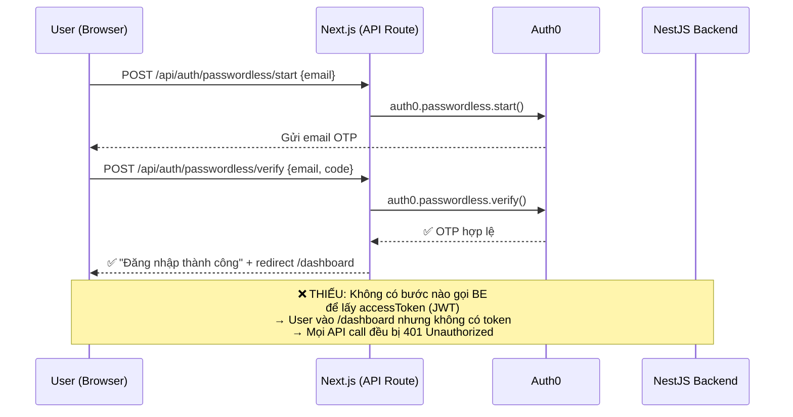
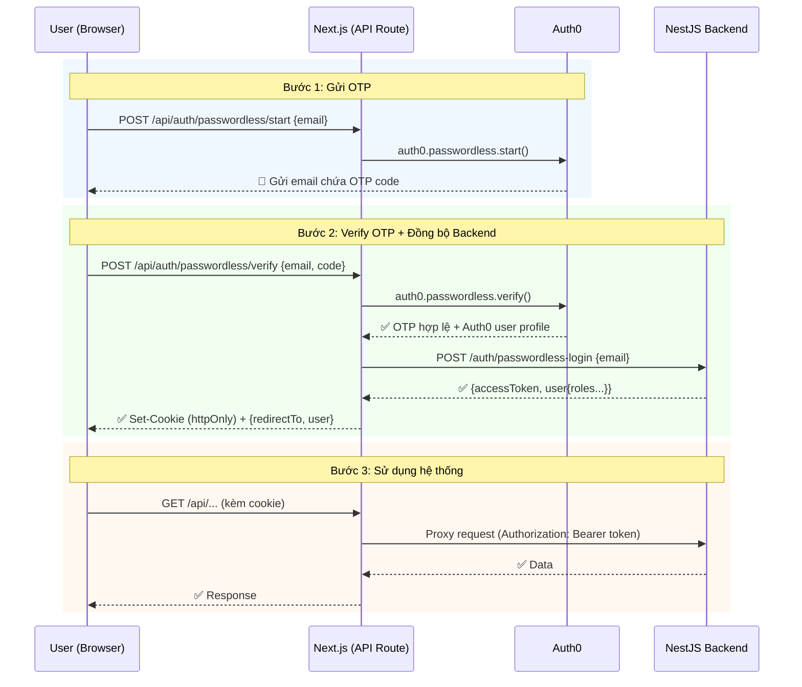
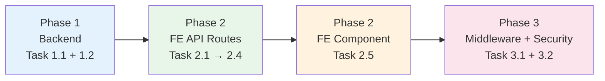

# 🔐 Plan: Passwordless Login — Auth0 (FE) + NestJS Backend

## Tổng quan hiện trạng

### Những gì đã có ✅
| Thành phần | File | Mô tả |
|---|---|---|
| **BE — Passwordless endpoint** | [auth.controller.ts](file:///home/ximent/AGU/KhoaLuanTotNghiep/TaskMenT/tm-backend/src/auth/auth.controller.ts#L39-L47) | `POST /auth/passwordless-login` nhận email, gọi `loginByEmail()` |
| **BE — loginByEmail()** | [auth.service.ts](file:///home/ximent/AGU/KhoaLuanTotNghiep/TaskMenT/tm-backend/src/auth/auth.service.ts#L146-L207) | Tìm user theo email → sign JWT → trả `accessToken` + user info |
| **BE — JWT Strategy** | [jwt.strategy.ts](file:///home/ximent/AGU/KhoaLuanTotNghiep/TaskMenT/tm-backend/src/auth/strategies/jwt.strategy.ts) | Xác thực Bearer token từ `Authorization` header |
| **FE — Auth0 Passwordless Start** | [start/route.ts](file:///home/ximent/AGU/KhoaLuanTotNghiep/TaskMenT/tm-frontend/app/api/auth/passwordless/start/route.ts) | Gửi OTP code qua Auth0 |
| **FE — Auth0 Passwordless Verify** | [verify/route.ts](file:///home/ximent/AGU/KhoaLuanTotNghiep/TaskMenT/tm-frontend/app/api/auth/passwordless/verify/route.ts) | Xác minh OTP code qua Auth0 |
| **FE — Login UI** | [loginPage.tsx](file:///home/ximent/AGU/KhoaLuanTotNghiep/TaskMenT/tm-frontend/components/client/auth/loginPage.tsx) | 2-step form: Nhập email → Nhập OTP |
| **FE — Auth0 Config** | [auth0.ts](file:///home/ximent/AGU/KhoaLuanTotNghiep/TaskMenT/tm-frontend/lib/auth0.ts) | `Auth0Client` SDK v4 setup |

### Vấn đề hiện tại ❌



**Chuỗi logic bị đứt đoạn:**
1. Auth0 verify OTP thành công → nhưng FE chỉ redirect về `/dashboard` mà **không gọi backend lấy JWT**
2. Backend có endpoint `POST /auth/passwordless-login` nhưng **FE chưa bao giờ gọi**
3. Không có cơ chế lưu `accessToken` (localStorage/cookie) sau khi đăng nhập thành công

---

## Kiến trúc mục tiêu



---

## Kế hoạch triển khai

### Phase 1: Backend — Hoàn thiện endpoint passwordless

#### Task 1.1: Bổ sung auto-create user nếu chưa tồn tại

> [!IMPORTANT]
> Hiện tại `loginByEmail()` throw lỗi nếu user chưa tồn tại. Cần bỏ comment phần auto-create hoặc tuỳ chọn.

**File:** [auth.service.ts](file:///home/ximent/AGU/KhoaLuanTotNghiep/TaskMenT/tm-backend/src/auth/auth.service.ts#L161-L179)

**Thay đổi:**
```diff
- // if (!user) {
- //   user = await this.prisma.user.create({
- //     data: {
- //       email,
- //       name: email.split('@')[0], 
- //       password: '',
- //     },
-     ...
- //   });
- // }
-
-   if (!user) {
-     throw new UnauthorizedException('Email not found');
-   }
+ if (!user) {
+   // Auto-create user khi lần đầu đăng nhập qua Auth0
+   // Password để trống vì user dùng passwordless
+   user = await this.prisma.user.create({
+     data: {
+       email,
+       name: email.split('@')[0],
+       password: '',   // Passwordless user — không dùng password
+     },
+     include: {
+       systemRoles: { include: { role: true } },
+       workspaceMemberships: {
+         where: { workspace: { deletedAt: null } },
+         include: {
+           role: { select: { name: true } },
+           workspace: { select: { id: true, name: true } },
+         },
+       },
+     },
+   });
+ }
```

**Lý do:** Khi user lần đầu đăng nhập bằng OTP qua Auth0, họ chưa có account trong DB. Cần auto-create để hệ thống hoạt động liền mạch.

#### Task 1.2: Validate email domain ở backend

**File:** [auth.service.ts](file:///home/ximent/AGU/KhoaLuanTotNghiep/TaskMenT/tm-backend/src/auth/auth.service.ts#L146)

**Thêm validation:**
```typescript
async loginByEmail(email: string): Promise<LoginResponse> {
  // Validate email format & domain
  const normalizedEmail = email.trim().toLowerCase();
  if (!normalizedEmail.endsWith('@student.agu.edu.vn')) {
    throw new UnauthorizedException('Only @student.agu.edu.vn emails are allowed');
  }
  // ... existing logic with normalizedEmail
}
```

---

### Phase 2: Frontend — Kết nối Auth0 verify → Backend JWT

#### Task 2.1: Cập nhật API route `verify` — Gọi backend sau khi Auth0 verify thành công

**File:** [verify/route.ts](file:///home/ximent/AGU/KhoaLuanTotNghiep/TaskMenT/tm-frontend/app/api/auth/passwordless/verify/route.ts)

**Thay đổi chính:**
```diff
    // Verify OTP qua Auth0
    await auth0.passwordless.verify({
      connection: "email",
      email,
      verificationCode: code,
    });

+   // === MỚI: Gọi backend để lấy JWT và thông tin user ===
+   const backendUrl = process.env.API_URL;
+   const beResponse = await fetch(`${backendUrl}/auth/passwordless-login`, {
+     method: "POST",
+     headers: { "Content-Type": "application/json" },
+     body: JSON.stringify({ email }),
+   });
+
+   if (!beResponse.ok) {
+     const beError = await beResponse.json().catch(() => ({}));
+     console.error("Backend passwordless-login error:", beError);
+     return NextResponse.json(
+       { message: "Xác thực thành công nhưng không thể tạo phiên đăng nhập." },
+       { status: 500 }
+     );
+   }
+
+   const beData = await beResponse.json();
+   const { accessToken, user } = beData.data;
+
+   // Set accessToken vào httpOnly cookie
+   const response = NextResponse.json({
+     message: "Đăng nhập thành công.",
+     redirectTo: "/dashboard",
+     user,
+   });
+
+   response.cookies.set("access_token", accessToken, {
+     httpOnly: true,
+     secure: process.env.NODE_ENV === "production",
+     sameSite: "lax",
+     path: "/",
+     maxAge: 60 * 60 * 24, // 24 giờ (hoặc khớp JWT expiresIn)
+   });
+
+   return response;

-   return NextResponse.json({
-     message: "Đăng nhập thành công.",
-     redirectTo: "/dashboard",
-   });
```

#### Task 2.2: Cập nhật API route `/api/auth/me` — Đọc token từ cookie

**File:** [me/route.ts](file:///home/ximent/AGU/KhoaLuanTotNghiep/TaskMenT/tm-frontend/app/api/auth/me/route.ts)

**Thay đổi:**
```typescript
import { NextRequest, NextResponse } from "next/server";

export const runtime = "nodejs";

export async function GET(request: NextRequest) {
  const token = request.cookies.get("access_token")?.value;

  if (!token) {
    return NextResponse.json({ user: null });
  }

  try {
    const backendUrl = process.env.API_URL;
    const beResponse = await fetch(`${backendUrl}/auth/me`, {
      headers: { Authorization: `Bearer ${token}` },
    });

    if (!beResponse.ok) {
      // Token hết hạn hoặc không hợp lệ
      const response = NextResponse.json({ user: null });
      response.cookies.delete("access_token");
      return response;
    }

    const user = await beResponse.json();
    return NextResponse.json({ user });
  } catch {
    return NextResponse.json({ user: null }, { status: 500 });
  }
}
```

#### Task 2.3: Cập nhật Axios interceptor — Gắn token vào request

Hiện tại [client.ts](file:///home/ximent/AGU/KhoaLuanTotNghiep/TaskMenT/tm-frontend/lib/axios/client.ts) dùng `baseURL: "/api"` → tất cả request đi qua Next.js API routes.

**Cần tạo proxy middleware** để forward request kèm `access_token` cookie sang backend:

**File mới:** `tm-frontend/app/api/proxy/[...path]/route.ts`

```typescript
import { NextRequest, NextResponse } from "next/server";

export const runtime = "nodejs";

const API_URL = process.env.API_URL!;

async function proxyRequest(request: NextRequest, params: { path: string[] }) {
  const token = request.cookies.get("access_token")?.value;
  const targetPath = params.path.join("/");
  const url = `${API_URL}/${targetPath}`;

  const headers: Record<string, string> = {
    "Content-Type": request.headers.get("content-type") || "application/json",
  };

  if (token) {
    headers["Authorization"] = `Bearer ${token}`;
  }

  const body = ["GET", "HEAD"].includes(request.method)
    ? undefined
    : await request.text();

  const response = await fetch(url, {
    method: request.method,
    headers,
    body,
  });

  const data = await response.text();
  return new NextResponse(data, {
    status: response.status,
    headers: { "Content-Type": response.headers.get("content-type") || "application/json" },
  });
}

export async function GET(req: NextRequest, { params }: { params: { path: string[] } }) {
  return proxyRequest(req, params);
}
export async function POST(req: NextRequest, { params }: { params: { path: string[] } }) {
  return proxyRequest(req, params);
}
export async function PUT(req: NextRequest, { params }: { params: { path: string[] } }) {
  return proxyRequest(req, params);
}
export async function PATCH(req: NextRequest, { params }: { params: { path: string[] } }) {
  return proxyRequest(req, params);
}
export async function DELETE(req: NextRequest, { params }: { params: { path: string[] } }) {
  return proxyRequest(req, params);
}
```

> [!NOTE]
> Nếu bạn đã có proxy middleware (file [proxy.ts](file:///home/ximent/AGU/KhoaLuanTotNghiep/TaskMenT/tm-frontend/proxy.ts)), cần kiểm tra lại để tích hợp thống nhất.

#### Task 2.4: Thêm API route logout — Xoá cookie

**File mới:** `tm-frontend/app/api/auth/logout/route.ts`

```typescript
import { NextResponse } from "next/server";

export async function POST() {
  const response = NextResponse.json({ message: "Đăng xuất thành công." });
  response.cookies.delete("access_token");
  return response;
}
```

#### Task 2.5: Cập nhật LoginPage — Lưu user info sau khi verify thành công

**File:** [loginPage.tsx](file:///home/ximent/AGU/KhoaLuanTotNghiep/TaskMenT/tm-frontend/components/client/auth/loginPage.tsx#L120-L149)

**Thay đổi nhỏ** ở `handleVerifyOtp`:
```diff
  async function handleVerifyOtp(values: OtpStepValues) {
    // ... existing code ...

      if (!response.ok) {
        setApiError(data.message || "Mã xác minh không đúng hoặc đã hết hạn.");
        return;
      }

+     // Cookie access_token đã được set bởi API route (httpOnly)
+     // User info có thể lưu vào context/store nếu cần
      setApiSuccess("Xác thực thành công! Đang chuyển hướng vào hệ thống...");
      const redirectUrl = data.redirectTo || "/dashboard";
      setTimeout(() => {
        router.push(redirectUrl);
      }, 600);
```

> [!TIP]
> Thay đổi chính ở FE login page rất nhỏ vì logic cookie đã được xử lý ở API route (Task 2.1). Frontend component chỉ cần redirect.

---

### Phase 3: Bảo mật & Edge Cases

#### Task 3.1: Xử lý trường hợp Google Login cũng cần sync với backend

Hiện tại nút Google login trỏ đến `/api/auth/login?connection=google-oauth2`. Cần đảm bảo sau khi Auth0 callback, cũng gọi backend `passwordless-login` để lấy JWT.

**File cần tạo/cập nhật:** `tm-frontend/app/api/auth/callback/route.ts`

```typescript
// Sau khi Auth0 OAuth callback → lấy email → gọi BE passwordless-login → set cookie
```

#### Task 3.2: Middleware bảo vệ route `/dashboard`

**File mới:** `tm-frontend/middleware.ts`

```typescript
import { NextRequest, NextResponse } from "next/server";

export function middleware(request: NextRequest) {
  const token = request.cookies.get("access_token")?.value;
  const isAuthPage = request.nextUrl.pathname.startsWith("/auth/login");

  // Chưa đăng nhập → redirect về login
  if (!token && !isAuthPage) {
    return NextResponse.redirect(new URL("/auth/login", request.url));
  }

  // Đã đăng nhập → không cho vào login nữa
  if (token && isAuthPage) {
    return NextResponse.redirect(new URL("/dashboard", request.url));
  }

  return NextResponse.next();
}

export const config = {
  matcher: ["/dashboard/:path*", "/auth/login"],
};
```

---

## Tóm tắt các file cần thay đổi

### Backend (`tm-backend`)
| # | File | Hành động | Mô tả |
|---|---|---|---|
| 1 | [auth.service.ts](file:///home/ximent/AGU/KhoaLuanTotNghiep/TaskMenT/tm-backend/src/auth/auth.service.ts) | **Sửa** | Bỏ comment auto-create user + validate email domain |

### Frontend (`tm-frontend`)
| # | File | Hành động | Mô tả |
|---|---|---|---|
| 2 | [verify/route.ts](file:///home/ximent/AGU/KhoaLuanTotNghiep/TaskMenT/tm-frontend/app/api/auth/passwordless/verify/route.ts) | **Sửa** | Sau Auth0 verify → gọi BE lấy JWT → set httpOnly cookie |
| 3 | [me/route.ts](file:///home/ximent/AGU/KhoaLuanTotNghiep/TaskMenT/tm-frontend/app/api/auth/me/route.ts) | **Sửa** | Đọc token từ cookie → gọi BE `/auth/me` |
| 4 | `app/api/proxy/[...path]/route.ts` | **Tạo mới** | Proxy tất cả API request kèm Bearer token |
| 5 | `app/api/auth/logout/route.ts` | **Tạo mới** | Xoá cookie khi logout |
| 6 | [loginPage.tsx](file:///home/ximent/AGU/KhoaLuanTotNghiep/TaskMenT/tm-frontend/components/client/auth/loginPage.tsx) | **Sửa nhỏ** | Không cần thay đổi lớn — cookie tự set qua API route |
| 7 | `middleware.ts` | **Tạo mới** | Bảo vệ route, redirect logic |
| 8 | `app/api/auth/callback/route.ts` | **Tạo mới** | Handle Auth0 OAuth callback cho Google login |

---

## Thứ tự triển khai đề xuất



> [!WARNING]
> **Quan trọng:** Cần kiểm tra file [proxy.ts](file:///home/ximent/AGU/KhoaLuanTotNghiep/TaskMenT/tm-frontend/proxy.ts) hiện có để tránh trùng lặp logic proxy. Nếu đã có proxy/rewrite trong `next.config.ts`, có thể cần điều chỉnh approach cho Task 2.3.

---

Bạn muốn tôi bắt đầu triển khai từ Phase nào? Hoặc nếu muốn điều chỉnh approach (ví dụ: không auto-create user, dùng localStorage thay cookie, v.v.), hãy cho tôi biết!
